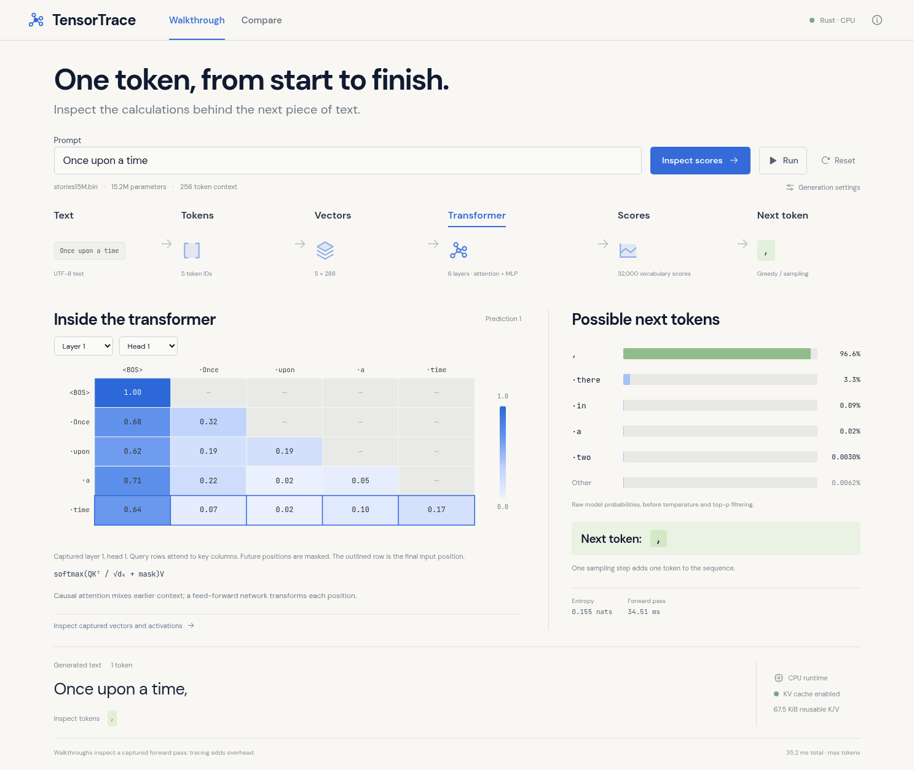
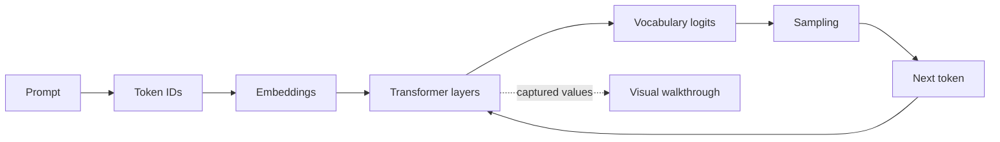
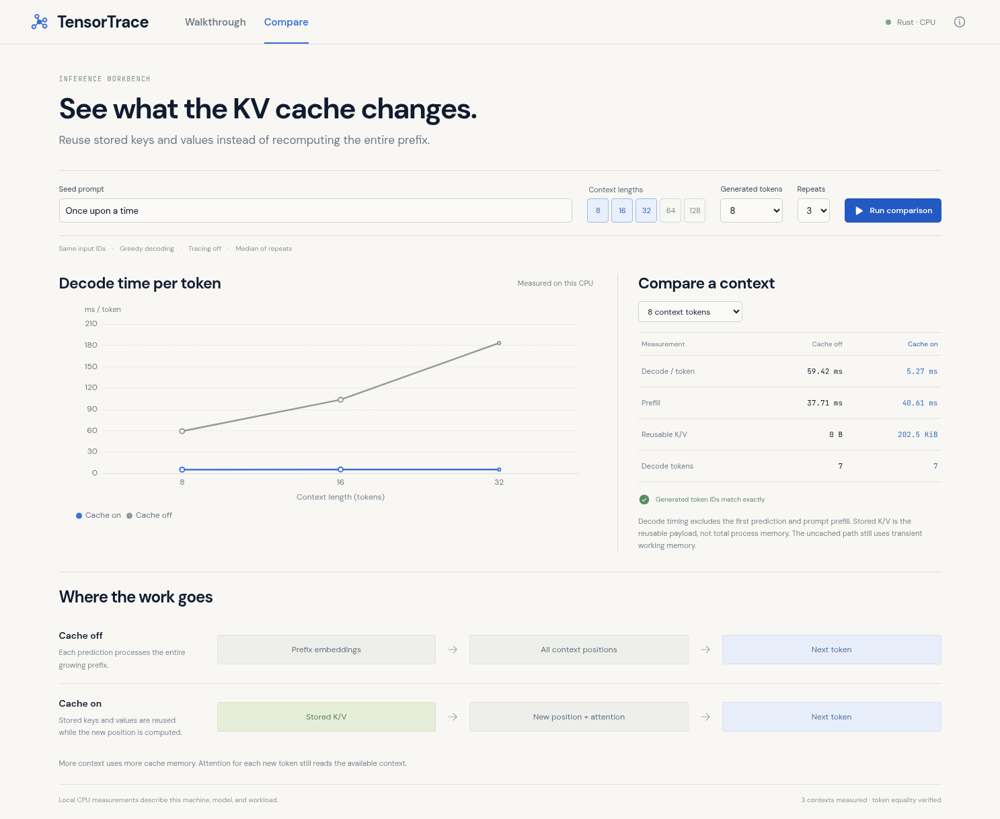

# TensorTrace

[](https://github.com/rohansikder/tensor-trace/actions/workflows/ci.yml)

A Rust LLM inference engine with an interactive visual debugger for token generation, attention, and KV cache performance.

Type a prompt, generate a token, and inspect the actual computation: token IDs, embedding coordinates, a causal attention matrix, feed-forward activations, and vocabulary probabilities. Switch to **Compare** to measure cached and uncached decoding on the same workload.

The runtime implements the model's forward pass directly in Rust. It loads a small pretrained TinyStories checkpoint and runs on the CPU without a hosted inference API. NumPy is used separately for numerical validation.



## Run it

Prerequisites: Rust through `rustup` (the repository pins toolchain 1.99.1), Node.js 22.12+ or 24+, Python 3.10+, and `make`. The default model download is approximately 61 MB. First builds also download Rust and JavaScript dependencies.

```bash
git clone https://github.com/rohansikder/tensor-trace.git
cd tensor-trace
make setup
make build
make serve
```

Open **http://localhost:8787**. The server serves the compiled console and the Rust API from the same origin. The default listener is loopback. After setup, generation does not require network access.

For frontend development, keep the Rust server running and use `make dev` in another terminal. Vite proxies `/api` to port 8787.

## Follow one prediction

1. Enter a story prefix such as **Once upon a time**. The supplied model is trained for short story completion, not instruction-following chat.
2. Use **Step through** to inspect a computed token through the text, tokenization, vectors, transformer, scores, and sampling views.
3. Select a layer and attention head to capture that part of the actual forward pass. Masked future positions remain unavailable.
4. Use **Run** to stream generated tokens. Select a generated token to inspect its recorded trace.
5. Adjust greedy or seeded temperature/top-p sampling, or compare retained K/V state with full-prefix recomputation.

The visual stages inspect a numerical trace at a human pace. They are not a claim that the model thinks in readable stages. Raw model probabilities are shown before temperature/top-p filtering; attention weights describe information mixing rather than a model's reasoning narrative.

## What is implemented

- Legacy float32 Llama-family checkpoint loading, validated dimensions, tied/untied classifiers, and BPE tokenization with byte fallback.
- RMSNorm, rotary positions, causal multi-head/grouped-query attention, residuals, SwiGLU, and vocabulary logits.
- Greedy decoding and deterministic seeded temperature/top-p sampling.
- Reusable K/V state and a separate uncached path that recomputes the growing prefix.
- Actual vector samples, selected-head attention matrices, next-token distributions, and timing observations.
- A bounded local JSON/SSE API, command-line generation and inspection, and a responsive React console.
- Independent numerical checks against a separately implemented NumPy full-sequence reference.



## Read the benchmark correctly

Compare constructs exact context lengths from the seed prompt's token IDs, warms both paths, alternates their execution order, and reports the median of repeated measurements. Greedy output token IDs must match. Tracing is disabled during timing.

Prefill produces the first prediction; decode timing covers later predictions. The comparison separates prefill from steady decoding. **Reusable K/V** is the active retained payload, not total allocated memory or process RSS. The uncached path still needs temporary K/V values while computing its prefix.

Measurements describe this model, implementation, CPU, compiler, and workload. They are not an across-hardware speed guarantee. Details and formulas are in [the architecture guide](docs/architecture.md).



The [recorded results](docs/results/README.md) include raw timings, numerical error reports, hardware details, and browser verification. The screenshots show the running application with actual model output.

## Command-line tools

After `make build`:

```bash
target/release/tensor-trace model
target/release/tensor-trace generate --prompt "Once upon a time" --max-tokens 24
target/release/tensor-trace generate --prompt "Once upon a time" --temperature 0.7 --seed 42 --json
target/release/tensor-trace inspect --tokens 1,42,7,300 --layer 2 --head 1 --cache on
target/release/tensor-trace bench --context-lengths 8,16,32 --max-tokens 8 --repeats 3
```

Global `--model` and `--tokenizer` options select compatible files. Generation context must fit the checkpoint's capacity. The included model has six layers, six heads, 288 embedding dimensions, 32,000 vocabulary entries, and a 256-token context.

## Validation

```bash
make test
make check
python3 -m venv .venv
.venv/bin/pip install -r validation/requirements.txt
OPENBLAS_NUM_THREADS=1 .venv/bin/python -m unittest discover -s validation -p 'test_*.py'
OPENBLAS_NUM_THREADS=1 .venv/bin/python validation/check.py
OPENBLAS_NUM_THREADS=1 .venv/bin/python validation/check.py \
  --model models/stories15M.bin --tokenizer models/tokenizer.bin \
  --output build/pretrained-numeric-validation.json
```

The independent reference computes a whole-sequence forward pass with NumPy matrix operations. It checks all final logits, the selected attention matrix, causal masking, normalization, greedy choices, and cached/uncached agreement. Tiny deterministic **untrained fixtures** cover grouped K/V heads and shared/separate classifiers. They are test assets; the application does not use them as a fallback model.

See [validation methodology](validation/README.md), [model integrity and provenance](models/README.md), and [the API contract](docs/api-contract.md). GitHub Actions runs Rust formatting/lint/tests, frontend checks, and numerical validation with both fixtures and the downloaded pretrained checkpoint.

The recorded validation includes **39 Rust unit/API tests**, **9 NumPy reference tests**, **26 Rust/NumPy numerical checks**, and **12 browser scenarios**. An additional optional cross-check compares three pretrained contexts with the pinned canonical C implementation. These are different checks, not a single combined test count.

To reproduce the browser checks, keep `make serve` running, then use a second terminal:

```bash
.venv/bin/pip install -r scripts/requirements-browser.txt
.venv/bin/python -m playwright install chromium
.venv/bin/python scripts/browser_check.py
```

Browser checks exercise streaming, selected-head traces, cancellation, cache comparison, keyboard access, and mobile layouts. CI also starts a separate server with deliberately missing weights to verify its unavailable state. Screenshots and machine-readable reports are uploaded as CI artifacts.

## Scope

This is a local educational CPU inference runtime and debugger. It implements inference, not model training. It supports the documented legacy checkpoint format rather than arbitrary GGUF or Hugging Face architectures. It does not include GPU kernels, quantization, instruction tuning, or a hosted multi-user service.

Missing or invalid model files produce an explicit unavailable state. There is no canned generation or random-weight fallback. Cancellation and execution bounds are documented in [the API contract](docs/api-contract.md).

## Repository map

```text
engine/       Rust model loader, tokenizer, math, sampling, cache, and traces
server/       Rust HTTP/SSE API, workload controls, benchmarks, and CLI
web/          React walkthrough and performance comparison
validation/   Independent NumPy reference and deterministic numeric fixtures
scripts/      Pinned model setup and verification tools
docs/         Architecture, API, implementation plan, and measured evidence
models/       External downloaded assets, excluded from Git
```

Code is licensed under [MIT](LICENSE). External model sources and their terms are recorded in [THIRD_PARTY.md](THIRD_PARTY.md).
