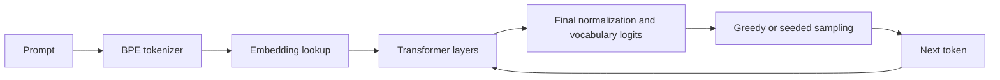

# How the runtime works

## A forward pass

The runtime reads a supported checkpoint once. Model weights and tokenizer vocabulary are immutable; each inference run owns its activations, sampling state, and K/V buffers. The HTTP layer shares the loaded engine and limits expensive concurrent work.

Text is encoded with the checkpoint's BPE vocabulary. Each token selects a row of the embedding table. A transformer layer then:

1. Applies RMS normalization and projects the activation into query, key, and value vectors.
2. Rotates query and key coordinates using their sequence position (RoPE).
3. Scores queries against the available keys, scales by the square root of head dimension, masks future positions, and applies softmax.
4. Uses those attention probabilities to mix value vectors, projects the result, and adds the residual.
5. Applies RMS normalization and a SwiGLU feed-forward network, then adds its residual.

After the final layer, RMS normalization and the classifier produce one logit per vocabulary entry. Greedy decoding selects the largest logit. Seeded temperature/top-p sampling offers a repeatable stochastic alternative. The selected token is decoded and appended to the sequence.

The model is the small pretrained TinyStories checkpoint documented in [model provenance](../models/README.md). It is not trained by this project. The engine supports its legacy float32 Llama-family format; it is not a general implementation of every transformer architecture.

## What the debugger observes

Tracing captures actual vector coordinates, the selected layer/head's causal attention probabilities, and output logits/probabilities. Upper-triangle attention entries are masked. Layer/head controls choose what is observed; they do not change the model's weights or generation algorithm.

The interface presents stages of a recorded forward pass so that the computation can be inspected at a human pace. Sampling is downstream from all transformer layers. A raw next-token probability is the model's softmax before temperature and top-p filtering; it is not necessarily the probability in the sampling distribution after those transformations.

Attention weights describe a numerical mixing operation. They are not a narrative of the model's reasoning or a complete explanation of its answer. Vector samples are coordinates from actual activations, not a semantic map.

## Cache comparison

With caching enabled, each layer retains previous tokens' keys and values. Subsequent decode steps compute the new token's activations while attending to cached context. With caching disabled, each step recomputes the full prefix. New-token attention still grows with context length when caching is enabled.

The comparison uses the same exact input token IDs, greedy decoding, and generation count for each mode. Both paths are warmed; execution order alternates across repetitions; timings are reported as medians. Output-token equality is checked. Tracing is disabled during timing.

Prefill produces the distribution for the first generated token. Decode timing covers later generated tokens, so `decodeTokens = generatedTokens - 1`. A run ending immediately has no decode samples. Prefill, decode, and total times are distinct quantities. Prefill/decode timings cover forward computation and the documented sampling/summary work. The separate `totalMs` field measures the generation loop, including trace construction and synchronous callbacks; streamed token serialization or backpressure can therefore increase it. It excludes initial tokenization/session allocation and final HTTP response serialization, and is not end-to-end request latency.

`kvCacheBytes` describes the active reusable K/V payload. It does not measure total process RSS, allocator capacity, weights, activations, or temporary buffers. Uncached inference still needs temporary K/V values while computing a full prefix. The field measures retained reusable state, not the claim that uncached inference uses zero memory.

Local CPU timings depend on hardware, compiler, sequence length, workload, and other processes. They are useful observations of this implementation rather than a general speed claim.

## Execution boundaries

The local server loads model files from disk and runs inference without an external model provider. Missing or invalid assets produce an explicit unavailable state; the service does not substitute random weights or canned text.

The default listener is loopback. Generation and benchmark requests have workload limits, and expensive work is gated. Cancellation is observed at token boundaries; a matrix operation already in progress is not preempted. The CLI provides explicit token inspection for independent validation.

The intended scope is an educational CPU runtime and local debugging console. GPU kernels, quantized model formats, model training, instruction tuning, multi-user authentication, and hosted deployment are separate extensions.
